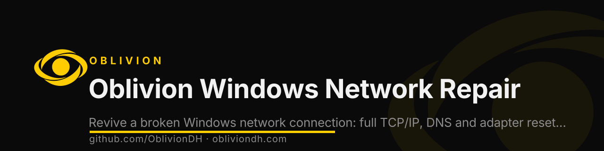

<p align="center">
  <a href="https://obliviondh.com"></a>
</p>

<h1 align="center">Oblivion Windows Network Repair</h1>

<p align="center">
  
  
  
  <a href="https://discord.gg/f4mZBU9xS8"></a>
</p>

<p align="center"><b>Revive a broken Windows network connection: full TCP/IP, DNS and adapter reset when nothing else works. By Oblivion.</b></p>

<p align="center">`windows` · `networking` · `tcp-ip` · `dns` · `network-repair` · `winsock-reset`</p>

---

**Engineered by Oblivion**  

🪟 Using Windows? First of all, **I'm sorry**. Second of all, you're probably here because your connection is slower than a **dial-up modem from 2003** caught in a hurricane.  <br><br>
**Internet Optimization Script v5.0** is here to save your miserable excuse of a network stack — not because you deserve it, but because **we got bored** and decided to do what Microsoft **still can't**.

***

## ⚙️ Features

- 🔁 **IP Configuration Refresh**  
  Because Windows can’t DHCP properly unless you **beg it**.<br><br>

- 🧹 **DNS Cache Flush**  
  Clears the **rotting digital junk** Windows has been hoarding like your grandma’s attic.<br><br>

- 💥 **TCP/IP Stack Reset**  
  Smashes your network stack with a hammer. You're welcome.<br><br>

- 🚫 **TCP "Optimizations" Disablement**  
  Disables the "smart" features that made your internet feel like you're browsing from a **fridge**.<br><br>

- 📦 **MTU Adjustment**  
  Sets MTU to 1500 — like it always should’ve been, if anyone at Microsoft had passed **Networking 101**.<br><br>

- 🌐 **Google Public DNS**  
  Replaces your ISP’s DNS server, which was probably located in a **Soviet-era basement**.<br><br>

- 🧠 **ARP Cache Reset**  
  Forces Windows to stop talking to ghosts of routers past.<br><br>

- 🧭 **Route Cleanup**  
  Deletes junk routes so bad, even **Clippy would’ve told you to give up**.

***

## 🛠️ Usage

1. **Download** the script.  
2. **Run it as Admin**, because Windows still thinks you’re an infant with a keyboard.  
3. Watch it repair the damage caused by years of neglect, while Windows cries silently in a corner. 🧎‍♂️💻

***

## 📋 Requirements

- Any Windows system still shambling along.  
- Admin rights (because Microsoft thinks "power user" means **you own RGB lights**).

***

## 💻 Example Output

```bash
Renewing IP... because Windows gave you that 169.254 clown IP again.
Flushing DNS... hope you didn’t enjoy waiting 30 seconds to load Google.
Resetting TCP/IP... surprise! It was broken. Deeply.
Deleting trash routes... how did these even get here?
All done. Network: optimized. Windows: ashamed.
Script by Oblivion — doing Microsoft’s job since always.
```

***

## 📜 License

Use it, tweak it, print it out and **burn it to a disc just to feel something again**. Just credit us. Or don’t. **Windows won’t notice either way.**

***

## 📞 Support

**Discord:** https://discord.gg/na8gqhQYJR  
Vent, cry, or ask for help. We’re used to hearing pain from **Windows fans**.

***

## ⚠️ Disclaimer

This script changes system settings. If it breaks something, blame **Windows** — we just exposed the cracks. Backup your system, unless you enjoy reinstalling Windows... again... for the third time this week.

***

## 🔥 Bonus: Killing Edge

Let me know if you want an **_Advanced Edition_** that not only optimizes your internet,  
but also **permanently deletes Edge** — that sad, reanimated corpse of Internet Explorer  
dressed up in Chrome cosplay trying to convince your grandma it’s a “modern browser.” 🪦👻

Let’s be real:  
**Edge is Internet Explorer in skinny jeans pretending to be useful.**  
If you're still defending it, you're either **in denial**, or **you work at Microsoft**.

We can fix that too.  
**FOR FREE.** 😈

***

**Oblivion**  
🔥 Fixing Windows one insult and script at a time — because someone f***ing has to.

--- 

Let me know if you want to include a *payload* that changes the system sound to a scream every time Edge opens.

---

Developed with much anguish by [@ivanbg_2004](https://github.com/ivanbg2004) and forced to be remastered by [Oblivion](https://odh.ivan-vcard.xyz) 6 years later.
Oblivion is a Linux-first company, but we reluctantly support other platforms.


## About Oblivion

Built by [**Oblivion**](https://obliviondh.com) — cybersecurity, cloud and AI. This tool is part of the Oblivion open-source toolkit.

- 🌐 Website: [obliviondh.com](https://obliviondh.com)
- 🎓 Learn: [Oblivion Academy](https://academy.obliviondh.com)
- 💬 Community: [Discord](https://discord.gg/f4mZBU9xS8)
- 🔗 All links: [linktr.ee/ivanbg2004](https://linktr.ee/ivanbg2004)
- 👤 Author: [Ivan Barnola Gasch](https://www.linkedin.com/in/ivanbg2004/)

<sub>Keywords: windows, networking, tcp-ip, dns, network-repair, winsock-reset, batch-script, troubleshooting, sysadmin.</sub>

<p align="center"><sub>© 2026 Oblivion. If this project helped you, leave a ⭐ — it helps others find it.</sub></p>
